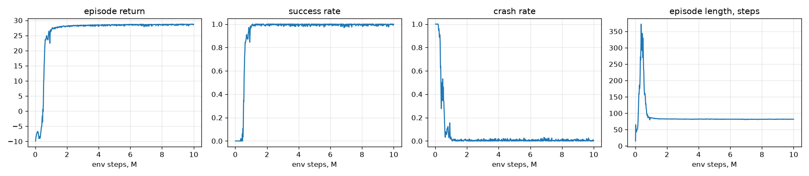
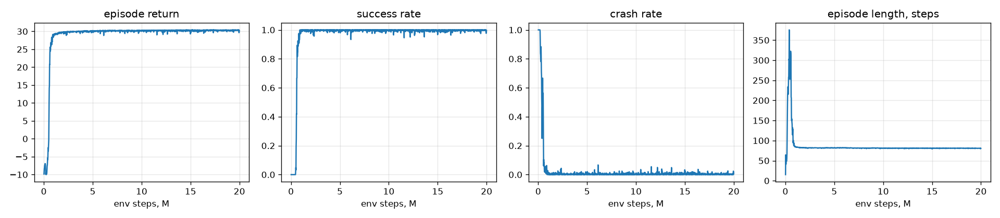
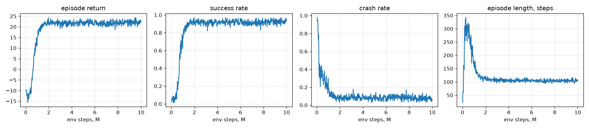

# Assignment 2: RL

Maxim Iziumov, AAI-02

Code: [src/algorithms/ppo.py](../src/algorithms/ppo.py), [src/train.py](../src/train.py), [src/evaluate.py](../src/evaluate.py), [src/benchmark.py](../src/benchmark.py). The environment is described in [report 1](assignment1.md).

## 1. Experimental setup and RL model

### The task as an MDP

The observation vector contains 28 values: 16 ray distances and 12 additional features. The velocities of moving obstacles are not included in the observation, so the task is partially observable.

The action is continuous, $a \in [-1, 1]^2$ (acceleration and steering).

The reward is the progress along the path, small penalties for deviation, time and jerky actions, and +10 or -10 for reaching the goal or crashing (report 1, section 3).

An episode lasts at most 450 steps at 15 Hz, which is 30 s. On reset the heading of the agent is randomly perturbed by up to 0.3 rad, so the policy cannot be a single memorised trajectory.

### Algorithm: PPO

PPO is an on-policy actor-critic method. One iteration works as follows.

First, $N$ parallel environments run $T$ steps with the current stochastic policy $\pi_\theta$, which gives a batch of $N \cdot T$ transitions.

Second, advantages are computed with Generalized Advantage Estimation (GAE). The parameter $\lambda$ trades off bias (TD) against variance (Monte Carlo):

$$
\delta_t = r_t + \gamma V(s_{t+1})(1 - d_t) - V(s_t)
$$

$$
\hat A_t = \delta_t + \gamma\lambda (1 - d_t) \hat A_{t+1}
$$

The recurrence runs backwards over the rollout with $\hat A_T = 0$. The flag $d_t$ is 1 when step $t$ ends the episode and 0 otherwise. On a terminal step, $\hat A_t = \delta_t$.

Third, several epochs of SGD over minibatches maximise the clipped surrogate objective:

$$
L^{CLIP} = \mathbb{E}\left[\min\left(\rho_t \hat A_t,\ \mathrm{clip}(\rho_t, 1 - \epsilon, 1 + \epsilon) \hat A_t\right)\right], \qquad \rho_t = \frac{\pi_\theta(a_t \mid s_t)}{\pi_{\theta_{old}}(a_t \mid s_t)}
$$

Clipping keeps the new policy close to the policy that collected the data, so the same data can safely be used for several epochs. The critic is trained with MSE towards $\hat A_t + V_{old}(s_t)$, also with clipping.

The actor and the critic are separate Equinox MLPs. Each takes 28 inputs and has two hidden layers of 128 units with tanh activations. The actor has two outputs and the critic has one. The policy is a diagonal Gaussian. The actor outputs the mean, and $\log\sigma$ is a separate trainable vector initialised to -0.5. The last actor layer is scaled by 0.01 at initialisation, so the initial actions are close to zero. The sampled action is clipped to $[-1, 1]$ inside the environment, while the log-probability is computed for the unclipped action. During evaluation the deterministic action (the mean) is used.

The hyperparameters are in PPOConfig. I use 128 parallel environments with rollouts of 128 steps, so one batch has 16384 transitions. Each update runs 4 epochs with 4 minibatches. $\gamma$ is 0.99 and the GAE $\lambda$ is 0.95. The clip $\epsilon$ is 0.2, the value loss coefficient is 0.5 and the entropy coefficient is 0. Adam starts with learning rate $3 \cdot 10^{-4}$ and decays it linearly to 0, and gradients are clipped to norm 0.5. Training uses 10M environment steps on maps 0 and 2 and 20M on map 1.

Map 2 additionally uses a start curriculum (start_frac = 0.5 in PPOConfig). During training, half of the episodes start at a random waypoint of the global path instead of the start cell. The heading points along the path with the same random noise of up to 0.3 rad. Evaluation always starts from the real start cell. Section 4 explains why this was needed.

## 2. Computational optimizations

The environment, the rollout, GAE and the update are all written in JAX, and XLA compiles them into one function per training iteration.

The whole training step is compiled with jax.jit. The function update() does a rollout, GAE and 4 by 4 SGD steps, and it is one compiled function (eqx.filter_jit). Python is called once per iteration, not on every environment step.

The environment code is vectorised with jax.vmap over 128 environments. The state is a batch of arrays and branches are replaced by jnp.where. Automatic reset is also done with jnp.where(done, reset_state, state) inside vmap, without Python conditions.

Python loops are replaced by jax.lax.scan for the rollout over time, the backward pass of GAE, the epochs and the minibatches. Each loop is compiled once and runs entirely on the device.

The physics substeps inside one environment step use lax.fori_loop with a static number of iterations taken from env_params. The physics frequency of 120 Hz does not increase the number of RL steps.

The global path is computed only once in init_params, not on every step. In BaseEnv.step the dynamic programming path (100 iterations over the grid) is under lax.cond, but under vmap the cond turns into select, and both branches are computed on every step. The planner itself is a Dijkstra search in plain Python and NumPy that runs on the CPU. It is the only part of the code that is not JAX, and it is not part of the training loop.

There is no copying between host and device during training. Metrics are computed inside update and only scalars are returned to Python.

Measurements from [src/benchmark.py](../src/benchmark.py) on an Apple M1 CPU, environment only, rollout of 128 steps:

| Variant                                                | env steps per second | speedup |
| ------------------------------------------------------ | -------------------: | ------: |
| Python loop, 1 env (only step is jitted)               |                1 789 |      1x |
| jit + scan, 1 env                                      |                2 281 |    1.3x |
| jit + vmap + scan, 16 envs                             |               13 723 |    7.7x |
| jit + vmap + scan, 128 envs                            |              180 326 |    101x |
| jit + vmap + scan, 512 envs                            |              490 256 |    274x |
| 128 envs, path replanned every step as in BaseEnv.step |                6 457 |    3.6x |

Vectorisation gives the largest gain. On a CPU a single environment is too small to keep the cores busy, and most of its time goes to call overhead. Computing the path once makes the environment 28 times faster with 128 environments (180 326 against 6 457 steps per second).

The end-to-end training speed, including the network and the update, is about 70 to 80 thousand steps per second. Training for 10M steps on map 0 takes 125 s.

## 3. Difficulties and reflection

**Early training.** In the first rollout, every completed episode ended in a crash, mostly because on all maps the car starts very close to a wall, so every backward move results in a crash. So firstly agent has to learn not to move backwards. On map 0, around 400,000 training steps, episodes were lasting much longer, but none of the episodes completed in that rollout reached the goal. By about one million steps, roughly 97% of completed episodes reached it. So looking at episode length and success together made it easier to see when the agent started completing the route.

**Exploration on map 2.** The baseline policy usually ran out of time, agent just stayed still. This happens due to reward, in this map obstacles are directly before agent 2 times so during rollouts it crashed almost every time it tried to drive, with our reward standing still will give less penalty than crashing so agent just stands. Adding a timeout penalty did not improve its success rate because then with the reward less penalty is for crashing (crashes went up from 5% to 12%) which clearly does not make it any better. I changed the training setup so that each episode had a 50% chance of starting at a random waypoint along the route. This gave the agent more opportunities to reach the goal during training so agent was given a clue that final goal even can be reached. The final policy reached the goal in all 256 evaluation episodes from the original starting cell.

**Transfer to a different map.** Also as an interesting generalisation test I evaluated the policy trained each map on another. The only checkpoint that generalised was trained on map 0, it also passed map 1 which is probably because they are very similar. That made it clear that a high success rate on the training map gave me little information about how the policy would handle a different layout.

**Obstacle timing on map 1.** As one more experiment: the moving obstacles normally start in the same positions, so I checked how the policy handled a change in their timing. I shifted their starting positions along their usual trajectories by the equivalent of 0.5, 1, and 2 seconds. The policy reached the goal in all 256 episodes at each tested offset, the car starts crashing at around 5 seconds. This check covered changes in starting position while keeping the obstacle speeds and trajectories fixed.

## 4. Results and reproduction

I trained three agents, one per map. Evaluation uses the deterministic policy (the mean of the Gaussian) on 256 episodes with random initial heading ([src/evaluate.py](../src/evaluate.py)). Each cell shows the share of episodes that reach the goal and the mean time to the goal.

| Checkpoint                                  | training steps |  time | map 0             | map 1             | map 2             |
| ------------------------------------------- | -------------: | ----: | ----------------- | ----------------- | ----------------- |
| [ppo_map0.eqx](../checkpoints/ppo_map0.eqx) |            10M | 125 s | 100%, 5.4 s       | 100%, 5.5 s       | 0% (100% crashes) |
| [ppo_map1.eqx](../checkpoints/ppo_map1.eqx) |            20M | 281 s | 0% (100% crashes) | 100%, 5.4 s       | 0% (100% crashes) |
| [ppo_map2.eqx](../checkpoints/ppo_map2.eqx) |            10M | 180 s | 0% (100% crashes) | 0% (100% crashes) | 100%, 9.6 s       |

For comparison, pure pursuit without obstacle avoidance reaches the goal on map 0 in 11.6 s and crashes on map 1.

Map 2 is harder than maps 0 and 1. The route is longer (9.6 s to the goal against 5.4 s), and it has to cross moving obstacles twice. The vertical column crosses the path, and the goal lies in a pocket that can only be entered through the horizontal row (hhhh). This row wraps around the edge of the map and also passes through the start area.

With the baseline setup, none of the 256 evaluation episodes reached the goal. Of those, 243 (94.9%) timed out and 13 (5.1%) ended in a crash. In the episodes that timed out, the median distance travelled over the final 10 seconds was 0.92 m. With an entropy bonus averaged over the minibatch (`--ent-coef 0.01`) and 20M training steps, all 256 evaluation episodes timed out. The mean episode return was -4.41.

To find out what was missing I trained three more variants on map 2, each for 10M steps, and evaluated them from the real start cell:

| Variant                                 | success | crashes | timeouts |
| --------------------------------------- | ------: | ------: | -------: |
| baseline                                |      0% |    5.1% |    94.9% |
| timeout penalty of 10, equal to a crash |      0% |   11.7% |    88.3% |
| start curriculum, start_frac = 0.5      |    100% |      0% |       0% |
| start curriculum and timeout penalty    |    100% |      0% |       0% |

Both variants with the start curriculum reached the goal in all 256 evaluation episodes. Starting from waypoints along the route gave the agent more opportunities to reach the goal during training. The timeout penalty alone produced no successful episodes, and combining it with the curriculum gave the same success rate as the curriculum alone. The final checkpoint uses only the start curriculum.

Of the six transfers between different maps, only the policy trained on map 0 reached the goal on a new map. It succeeded in all 256 episodes on map 1. The other five transfers ended in crashes in every episode.

Videos:

[media/ppo_map0.mp4](../media/ppo_map0.mp4) shows map 0, 3 episodes, the goal is reached in all of them.

[media/ppo_map1.mp4](../media/ppo_map1.mp4) shows map 1, 3 episodes. The agent crosses the line of the moving column when the column goes up, at about 4 s.

[media/ppo_map0_on_map2.mp4](../media/ppo_map0_on_map2.mp4) shows the map 0 policy on map 2. It crashes, there is no generalisation.

[media/ppo_map2.mp4](../media/ppo_map2.mp4) shows map 2, 3 episodes, the goal is reached in all of them in about 9.5 s.

Learning curves (stochastic policy, computed over the episodes that finished in each rollout). On map 2 the training success rate stays around 0.93 and does not reach 1. These numbers include the curriculum episodes, and some random starts on the path are right next to a moving obstacle.





### Reproduction

```bash
pip install -r requirements.txt
export JAX_PLATFORM_NAME=cpu
# training, about 2 to 5 minutes each on an M1
python src/train.py --map-id 0 --total-timesteps 10000000 --num-envs 128
python src/train.py --map-id 1 --total-timesteps 20000000 --num-envs 128
python src/train.py --map-id 2 --total-timesteps 10000000 --num-envs 128 --start-frac 0.5
# evaluation of the deterministic policy on 256 episodes
python src/evaluate.py checkpoints/ppo_map0.eqx --map-id 0
# watch in a window or record a video (mp4 needs ffmpeg)
python src/play.py --controller ppo --checkpoint checkpoints/ppo_map0.eqx
python src/play.py --controller ppo --checkpoint checkpoints/ppo_map0.eqx --record media/ppo_map0.mp4 --episodes 3
# learning curves and benchmark
python src/plot_training.py checkpoints/ppo_map0_log.csv media/ppo_map0_curve.png
python src/benchmark.py
```

To reproduce the additional runs on map 2, save each variant to a separate directory:

```bash
python src/train.py --map-id 2 --total-timesteps 10000000 --num-envs 128 --out checkpoints/map2_baseline
python src/train.py --map-id 2 --total-timesteps 10000000 --num-envs 128 --timeout-penalty 10 --out checkpoints/map2_timeout
python src/train.py --map-id 2 --total-timesteps 10000000 --num-envs 128 --start-frac 0.5 --timeout-penalty 10 --out checkpoints/map2_curriculum_timeout
python src/train.py --map-id 2 --total-timesteps 20000000 --num-envs 128 --ent-coef 0.01 --out checkpoints/map2_entropy

python src/evaluate.py checkpoints/ppo_map2.eqx
for variant in baseline timeout curriculum_timeout entropy; do
    python src/evaluate.py "checkpoints/map2_${variant}/ppo_map2.eqx"
done
```

To reproduce the obstacle timing check on map 1, shift the moving obstacles along their trajectories by a given number of seconds:

```bash
for offset in 0.5 1 2 3 5; do
    python src/evaluate.py checkpoints/ppo_map1.eqx --obstacle-offset $offset
done
```
